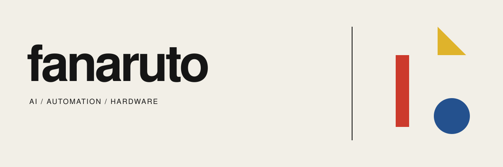

  <b>把 AI 做进工作流，也做进真实设备。</b> 
  I build practical tools across software, automation and hardware.

  <a href="https://collection.webfooo.com">Human Creator ↗</a>
  &nbsp; / &nbsp;
  <a href="https://github.com/fanaruto?tab=repositories&type=source">Source repositories</a>
  &nbsp; / &nbsp;
  <a href="https://github.com/fanaruto?tab=repositories&type=fork">Open-source workbench</a>

## Selected work

<table>
<tr>
<td width="50%" valign="top">

### Human Creator

**数据采集运营系统**

把项目需求、供应商协作、设备库存和生产日报串成可追踪的业务流程。

TypeScript · React / Next.js · Go · PostgreSQL · Docker

[Visit product ↗](https://collection.webfooo.com)

</td>
<td width="50%" valign="top">

### Hardware lab

**AI × 真实设备**

围绕 M5Stack / ESP32 探索 BLE 控制、语音交互与桌面 AI 设备，把屏幕里的能力带到手边。

M5Stack · ESP32 · BLE · Firmware

[Codex Micro firmware reference ↗](https://github.com/fanaruto/codex-micro-4-core2)

Public reference: fork of imliubo/codex-micro-4-core2.

</td>
</tr>
</table>

## On my workbench

| Area | What I explore | Public reference |
| :--- | :--- | :--- |
| **AI agents** | 个人助手、工具调用与知识工作流 | [hermes-agent](https://github.com/fanaruto/hermes-agent) · fork |
| **Automation** | 浏览器自动化、数据采集与可重复执行的任务 | [crawlee](https://github.com/fanaruto/crawlee) · fork |
| **Learning notes** | Python 爬虫的早期学习记录 | [CrawlerBook](https://github.com/fanaruto/CrawlerBook) |

Forks on this profile are references and experiments; credit belongs to their upstream authors.

---

Useful software. Real workflows. Physical interfaces.

